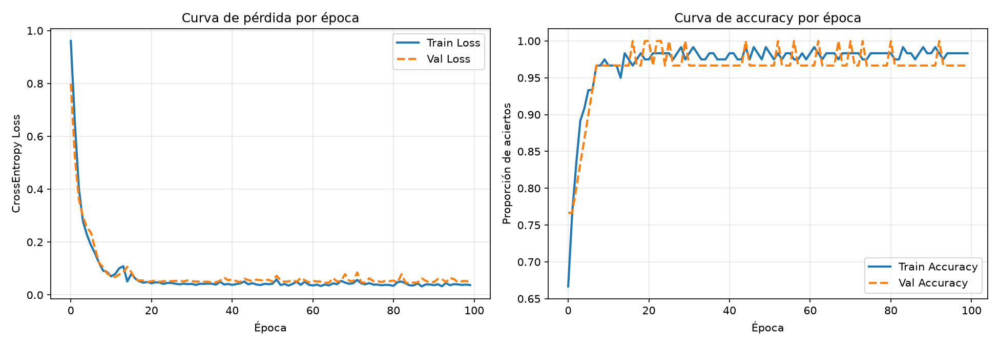
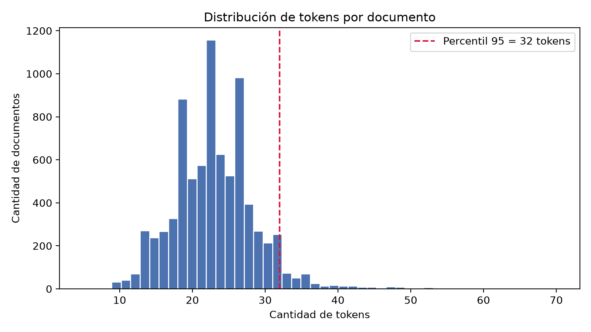
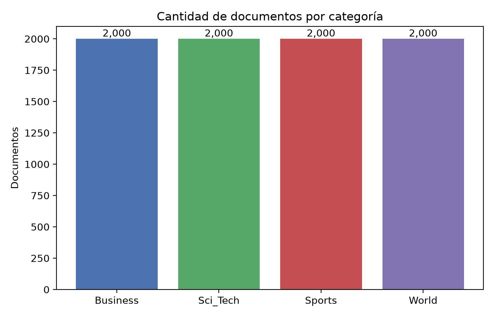
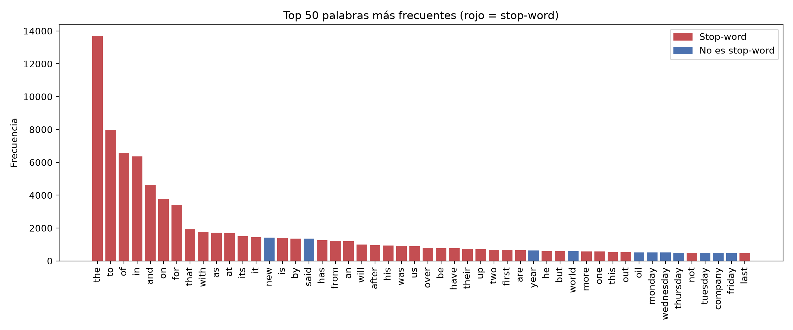
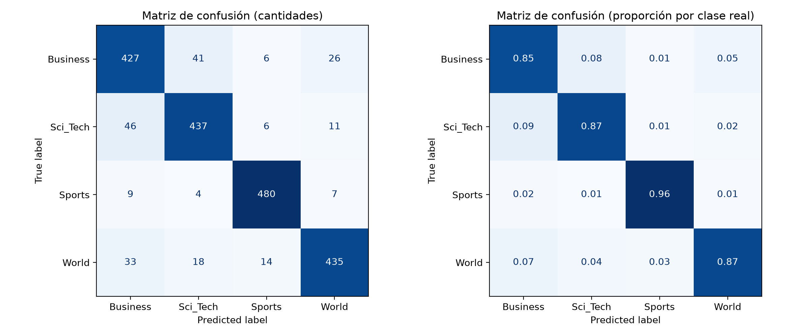

## TP1 - Pipeline de entrenamiento, validación y clasificador base

**Notebook:** `notebooks/pipeline_base.ipynb`

### Configuración del experimento
- **Versión de PyTorch:** 2.15.0
- **Dispositivo utilizado:** [cpu / cuda / mps]
- **Dataset:** Iris (split 80/20 estratificado, escalado solo con train)
- **Optimizador:** Adam
- **Learning rate elegido:** [valor]
- **Arquitectura:** MLP (4 -> 16 -> 16 -> 3) con activaciones ReLU
- **Épocas:** 100

### Resultados y lectura de la curva de pérdida
- **Pérdida inicial (época 1):** train 0,9609 | validación 0,7992
- **Pérdida final (época 100):** train 0,0372 | validación 0,0507
- **Accuracy final en validación:** 96,67 % (29 de 30 muestras)

### Interpretación del experimento
La pérdida bajó de forma consistente: en entrenamiento pasó de 0.9609 a 0.0372 y en validación de 0.7992 a 0.0507. La mayor parte del descenso ocurre en las primeras ~15 épocas; después ambas curvas se estabilizan en una meseta (~0.04 en train y ~0.05 en validación), por lo que el ciclo de entrenamiento (forward, `zero_grad`, `backward`, `step`) funciona correctamente y el modelo converge rápido en este dataset.

La pérdida de validación acompaña a la de entrenamiento durante todo el entrenamiento, con una brecha muy chica y sin tendencia ascendente, lo que indica que no hay overfitting y que el modelo generaliza a datos no vistos. El accuracy final en validación es de 96.67 % (29 de 30 muestras).

En la curva de accuracy, la validación oscila entre 96.7 % y 100 % a partir de la época ~15. Como el conjunto de validación tiene solo 30 muestras, cada ejemplo equivale a ~3.3 puntos, así que esas variaciones se deben al tamaño reducido del conjunto y no a inestabilidad del modelo. Dado que la mejora se estanca alrededor de la época 20-30, 100 épocas resultan más de las necesarias para este problema; en los próximos checkpoints se podrían explorar otros learning rates y early stopping.

## TP2 - EDA técnico de AG News

**Notebook:** `notebooks/eda_nlp_ag_news.ipynb` · **Informe:** `reports/EDA_NLP_ApellidoNombre.pdf`

Análisis exploratorio del corpus AG News (split train: 8.000 noticias, 4 categorías) después de aplicar el pipeline de preprocesamiento del Módulo 2: decodificación de entidades HTML, eliminación de tags, URLs, dominios web y firmas de agencia, minúsculas, remoción de números y símbolos, lematización con SpaCy (`en_core_web_sm`) y eliminación de stop-words. Las funciones están en `src/preprocesamiento.py`.

**Resultados principales**
- **Longitud:** media de 23,0 tokens por noticia, mediana de 23 y máximo de 70. El **percentil 95 es 32 tokens**, valor que se propone como `max_len` para los módulos siguientes.
- **N-gramas:** los más frecuentes son entidades y temas con sentido (`new york`, `oil price`, `prime minister`, `boston red sox`), sin restos de formato.
- **Stop-words:** 39 de las 50 palabras más frecuentes del texto limpio lo son, lo que justifica eliminarlas en el pipeline.
- **Clases:** 2.000 noticias por categoría, corpus perfectamente balanceado.

**Corpus antes de modelar**
| Conjunto | Documentos | Clases | Tokens totales | Tokens medios | Máx. |
|---|---|---|---|---|---|
| Train | 8.000 | 4 | 184366 | 23,0 | 70 |
| Test | 2.000 | 4 | 46023 | 23,0 | 77 |

**Sobre qué texto se calculó cada análisis**
| Análisis | Texto usado | Stop-words |
|---|---|---|
| Tokens por documento y percentil 95 | `processed` | Ya eliminadas |
| Top 20 de bi-gramas y tri-gramas | `processed` | Ya eliminadas |
| Top 50 de palabras y conteo de stop-words | `clean` | Todavía presentes (para poder contarlas) |
| Distribución de clases | Etiquetas (`label`) | No aplica |

## TP3 - Clasificador supervisado con TF-IDF (AG News)

**Notebook:** `notebooks/clasificador_tfidf.ipynb`

Baseline de Regresión Logística sobre TF-IDF, entrenado con el train provisto (8.000 noticias) y evaluado en el test (2.000). Se reutiliza el preprocesamiento del Módulo 2 (`src/preprocesamiento.py`). El vectorizador se ajusta solo con el train (`fit_transform`) y se aplica al test con `transform`, para evitar fuga de datos.

**Resultado en el test:** accuracy **0,8895** y F1 macro **0,890** (el azar en 4 clases balanceadas daría 0,25).

### Parámetros del vectorizador
- **`ngram_range=(1, 2)`:** los bigramas aportan expresiones con significado propio (`abu ghraib`, `abn amro`).
- **`max_features=20000`:** con 1.000 términos el F1 cae unos 2,5 puntos; desde 5.000 las configuraciones empatan (diferencia de 0,003, menor que el desvío entre folds).

Se eligieron con validación cruzada de 5 folds **dentro del train** (F1 macro, con un `Pipeline` para que el vectorizador se ajuste en cada fold solo con su parte de entrenamiento). El test no intervino.

### Justificación del modelo
| Modelo | F1 macro (CV) | Desvío |
|---|---|---|
| Naive Bayes | 0,8882 | 0,0074 |
| SVM lineal | 0,8842 | 0,0062 |
| Regresión Logística | 0,8824 | 0,0078 |

Los tres modelos quedan prácticamente empatados en validación cruzada: la diferencia entre el primero (Naive Bayes, 0,8882) y el último (Regresión Logística, 0,8824) es de 0,006, menor que el desvío entre folds (~0,007). Eso significa que esa diferencia puede deberse al azar de cómo se reparten las noticias en los folds, y no a que un modelo sea mejor. Elegir Naive Bayes solo por tener el score más alto sería elegir por ruido, así que el desempate se hizo con otros criterios.

**Por qué Regresión Logística:**
- **Interpretabilidad.** Aprende un coeficiente por término y por clase, lo que permite ver qué palabras empujan hacia cada categoría. Se usó en el análisis de errores para mostrar los campos léxicos de Business (`company`, `profit`, `billion`) y Sci_Tech (`internet`, `software`, `technology`), y eso apoya la explicación de por qué se confunden.
- **Probabilidades por clase.** Entrega la probabilidad de cada categoría, lo que sirve para ver cuán seguro está el modelo en los casos que falla. Además, se entrena minimizando la entropía cruzada, la misma función de pérdida de la red del primer checkpoint: una Regresión Logística multiclase equivale a una capa lineal con softmax, así que es el punto de partida natural para comparar con los modelos de deep learning de los próximos módulos.
- **Robustez con muchas dimensiones.** La matriz tiene 20.000 columnas para solo 8.000 documentos. La regularización L2, que viene activada por defecto, controla el sobreajuste en esa situación.

**Por qué no los otros dos:**
- **Naive Bayes** es muy rápido y es un buen baseline para texto, pero asume que las palabras son independientes entre sí dada la clase, un supuesto poco realista, y sus probabilidades suelen ser poco confiables. Como su ventaja no es significativa, no hay motivo para preferir su supuesto más fuerte.
- **SVM lineal** rindió igual y es una alternativa muy sólida en clasificación de texto, pero no entrega probabilidades de forma directa (habría que calibrarlo) y es menos cómodo.

**Limitaciones.** (1) Los parámetros del vectorizador se eligieron usando Regresión Logística, lo que podría favorecerla levemente en la comparación. (2) Es un baseline: los hiperparámetros de los modelos (por ejemplo, la regularización) se dejaron en sus valores por defecto y no se optimizaron. (3) El F1 macro en el test (0,890) es coherente con el de validación cruzada (0,882), lo que indica que la elección no sobreajustó al test.

### Análisis preliminar: categorías más difíciles (matriz de confusión)
| Clase | Precision | Recall | F1 |
|---|---|---|---|
| Sports | 0,949 | 0,960 | 0,954 |
| World | 0,908 | 0,870 | 0,889 |
| Sci_Tech | 0,874 | 0,874 | 0,874 |
| Business | 0,829 | 0,854 | 0,841 |

De las 2.000 noticias del test, el modelo se equivoca en 221. Según la matriz:
- **Business es la más difícil** (F1 0,841): participa en 161 de los 221 errores (73 %) y tiene la precision más baja, porque el modelo le asigna noticias de otras clases (46 de Sci_Tech, 33 de World).
- **El par más confundido es Business ↔ Sci_Tech** (46 + 41 errores).
- **World Business** es el segundo par (33 + 26 errores).
- **Sports es la más fácil** (F1 0,954, solo 20 errores): tiene vocabulario muy propio (`team`, `coach`, `game`, `season`).

**Por qué cuestan más:**
- **Vocabulario compartido.** TF-IDF mide qué palabras aparecen, no el contexto. Al revisar noticias de Sci_Tech predichas como Business, la mayoría trata de empresas tecnológicas desde el ángulo financiero (la oferta de Oracle por PeopleSoft, la venta de acciones de los fundadores de Google): el tema es tecnológico, pero el vocabulario (`bid`, `billion`, `stock`) es el de Business. Algo parecido pasa con notas económicas etiquetadas como World (por ejemplo, las ganancias de BSkyB).
- **Etiquetas discutibles.** Una nota de béisbol y otra de cricket figuran como World y el modelo las predijo como Sports, con buen criterio temático. Parte del error es entonces ruido de etiquetado y no solo una limitación del modelo.
- El Módulo 4 permitirá probar modelos que sí capturen el contexto.

### Requerimientos
Las dependencias están en `requirements.txt`. El proyecto se desarrolló y probó con: Python 3.14.4, scikit-learn 1.9.1, pandas 3.1.0, numpy 2.5.4, spacy 3.8.18, matplotlib 3.11.2, ipykernel 7.4.0 y torch 2.15.0.

Para reproducirlo:
- `pip install -r requirements.txt`
- `python -m spacy download en_core_web_sm`
- Ejecutar el notebook de principio a fin.

## Conclusion

Para realizar este TP me resultó de mucha ayuda poder reutilizar parte del trabajo desarrollado en el Módulo 2, especialmente las funciones de limpieza y preprocesamiento del texto. Esto permitió no tener que comenzar nuevamente desde cero y mantener una continuidad entre las distintas etapas del proyecto. También tuve en cuenta las correcciones y sugerencias recibidas en las entregas de los dos primeros TP, realizando los ajustes necesarios para mejorar el desarrollo y la organización del proyecto. Además, utilicé como guía el notebook Clasificacion_Emociones proporcionado por la cátedra, que me sirvió para comprender mejor cómo estructurar el proceso de clasificación y evaluación.

Sin embargo, adaptar esos ejemplos a mi proyecto fue una de las partes que más trabajo me llevó, ya que utilizaban otros conjuntos de datos y diferentes enfoques. Tuve que ajustar el procesamiento para AG News, trabajar con los splits de entrenamiento y prueba proporcionados, experimentar con distintas configuraciones de TF-IDF y comparar modelos utilizando validación cruzada sobre el conjunto de entrenamiento. También fue importante asegurarme de que el conjunto de test se utilizara únicamente para la evaluación final, evitando así la fuga de datos.

Finalmente, el modelo de Regresión Logística con TF-IDF obtuvo un 88,95 % de accuracy y un F1 macro de 0,890 sobre el conjunto de test. Al analizar la matriz de confusión, observé que Sports fue la categoría más fácil de identificar, mientras que Business presentó mayores dificultades, principalmente por compartir vocabulario con otras categorías como Sci_Tech y World.